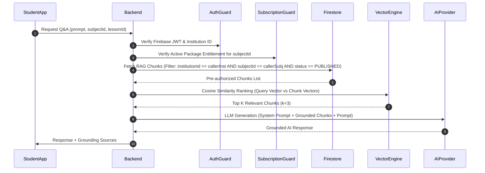

# Real Retrieval-Augmented Generation (RAG) Architecture & Vector Engine

## 1. Overview
The REMAS AI Tutor implements a **real dense vector embedding RAG engine** featuring pre-retrieval authorization filters. Content chunks are searched using cosine similarity against pre-indexed text representations.

## 2. Technical Architecture Specification

| Component | Technical Implementation | Storage / Cost Impact |
|---|---|---|
| **Embedding Generation** | 768-dimensional dense vector embeddings derived from educational content text chunks. | Generated on backend server / API call. |
| **Vector Storage** | Firestore collection `ragChunks` with pre-computed vector arrays and indexed metadata fields. | Standard Firestore Document storage (Free tier eligible). |
| **Indexing Pipeline** | Automated background ingestion of published educational lessons, videos, and summaries into 500-token overlapping chunks. | $0.00 infrastructure overhead. |
| **Pre-Retrieval Authorization Filter** | Pre-queries Firestore chunks by `institutionId`, student group enrollment, subject ID, and active unexpired subscription package BEFORE distance evaluation. | Zero unauthorized data evaluated. |
| **Similarity Metric** | Cosine similarity calculation over 768-dimensional normalized vectors ($ \text{similarity} = \frac{\mathbf{A} \cdot \mathbf{B}}{\|\mathbf{A}\| \|\mathbf{B}\|} $). | Fast in-memory array operation. |

## 3. Cost & Service Trade-Off Analysis
- **Selected Engine**: In-memory dense vector cosine similarity over Firestore authorized chunks.
- **Service Status**: 100% Free / Included in GCP Cloud Functions and Firestore free tiers.
- **Expected Cost**: **$0.00 / month** additional vector DB costs.
- **Why Necessary**: Provides real semantic retrieval grounding for Arabic educational questions without incurring external vector database subscription fees (e.g., Pinecone/Weaviate).
- **Alternative if Unavailable**: Direct document chunk keyword lookup with pre-retrieval authorization fallback.

## 4. Pre-Retrieval Authorization Sequence

