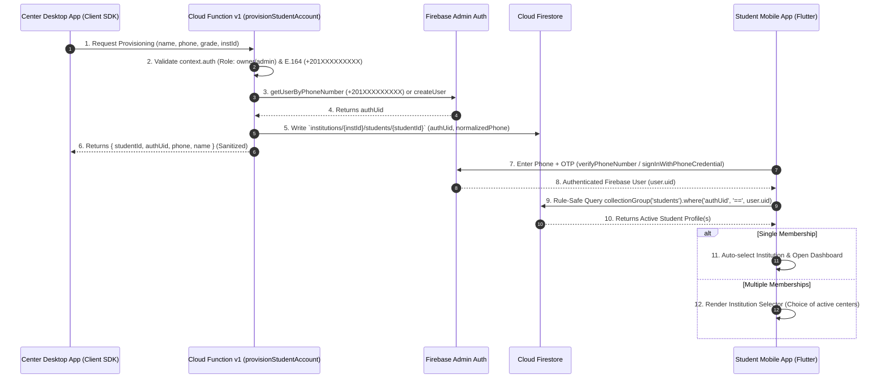

# STUDENT AUTHENTICATION ARCHITECTURE — PRODUCTION DOCUMENTATION

## 1. Executive Summary & Production Design
This document defines the production Student Authentication Architecture for **REMAS EDU SaaS Platform**.
Student identity provisioning is performed strictly server-side via **Firebase Cloud Functions (v1)** using E.164 phone normalization and Firebase Admin Auth. Client applications (`Center Desktop`, `Student Mobile App`) use strictly **Firebase Client SDKs** with zero embedded service-account credentials or Admin SDKs.

---

## 2. Sequence Diagram & Authentication Flow



---

## 3. Server-Side Provisioning Backend (Cloud Functions v1)
- **File:** `firebase/functions/index.js`
- **Function:** `provisionStudentAccount` (HTTPS Callable v1)
- **Caller Context:** Derived directly from `context.auth`. Unauthenticated callers or non-admin roles (`student`, `parent`) are rejected with `permission-denied`.
- **Tenant Isolation:** Client-supplied `institutionId` can NEVER override `context.auth.token.institutionId`. Cross-tenant attempts throw `permission-denied`.
- **E.164 Egyptian Phone Normalization:** Converts `01011112222` -> `+201011112222`. Validates regex `/^\+201[0125]\d{8}$/`.
- **Duplicate Prevention:** Rejects duplicate active student creation within the same institution (`DUPLICATE_STUDENT_IN_INSTITUTION`).
- **Multi-Tenant Identity Reuse:** Reuses existing Firebase Auth UID if the student is already enrolled in another institution center.

---

## 4. Student Firestore Schema & Preserved Document IDs
- **Collection Path:** `institutions/{institutionId}/students/{studentId}`
- **Document Structure:**
  ```json
  {
    "id": "STU_1726338000000_abcd",
    "studentCode": "STU-2026-123456",
    "institutionId": "inst_center_a",
    "authUid": "FIREBASE_AUTH_UID_12345",
    "name": "أحمد محمد علي",
    "phone": "01011112222",
    "normalizedPhone": "+201011112222",
    "guardianPhone": "01122223333",
    "guardianName": "محمد علي",
    "grade": "الصف الثالث الثانوي",
    "stage": "الثانوية",
    "groupId": "grp_math_1",
    "status": "ACTIVE",
    "createdAt": "2026-09-14T18:36:00.000Z",
    "updatedAt": "2026-09-14T18:36:00.000Z"
  }
  ```
- **Preserved Schema:** Existing `studentId` document key is preserved to avoid breaking existing grade/attendance references. `authUid` is stored explicitly inside the document.

---

## 5. Firestore Security Rules & Collection Group Query
- **Rules File:** `firebase/firestore.rules`
- **Collection Group Rule:**
  ```rules
  match /{path=**}/students/{studentId} {
    allow read: if isAuthenticated() && (request.auth.uid == resource.data.authUid && resource.data.status == 'ACTIVE');
  }
  ```
- **Rule-Safe Student App Query:**
  ```dart
  db.collectionGroup('students')
    .where('authUid', isEqualTo: user.uid)
    .where('status', isEqualTo: 'ACTIVE')
    .get()
  ```
- **Automated Rules Verification:** Tested against real Firebase Emulator via `@firebase/rules-unit-testing` (192 passing rules tests).

---

## 6. Mobile Student App UX (Arabic Phone + OTP)
- **File:** `student_app/lib/screens/login_screen.dart`
- **Step 1:** Enter Egyptian Mobile Number (`01XXXXXXXXX`) -> "إرسال رمز التحقق".
- **Step 2:** Enter 6-digit SMS OTP -> "تأكيد الدخول".
- **Step 3:** Post-OTP Membership Resolution (Single -> Direct Dashboard; Multiple -> Institution Selector Card).
- **Error Handling:** Clear Arabic user messages for invalid phone format, invalid OTP, expired session, network failures, and suspended/archived student accounts.

---

## 7. Migration of Legacy Student Records
- **Function:** `migrateExistingStudentAccount` (HTTPS Callable v1)
- Idempotent migration endpoint for legacy student documents created prior to Auth UID integration. Normalizes phone, provisions/links Auth UID, updates Firestore document, and preserves existing `studentId`.
